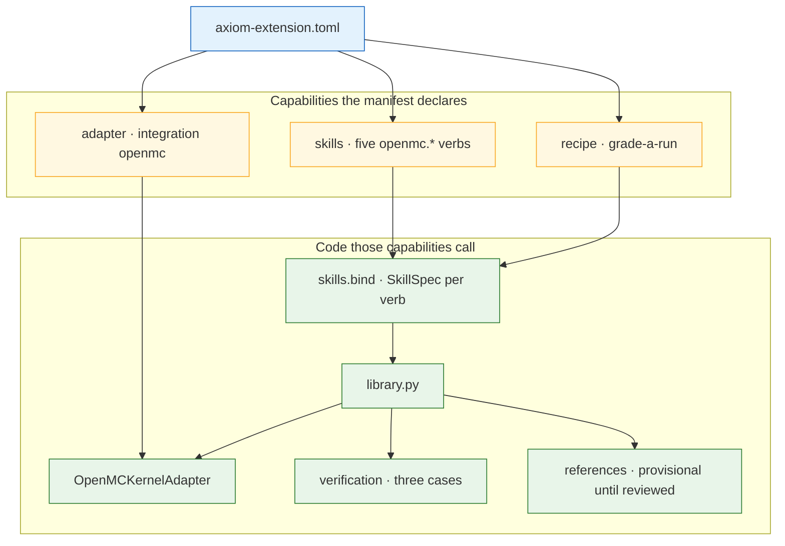
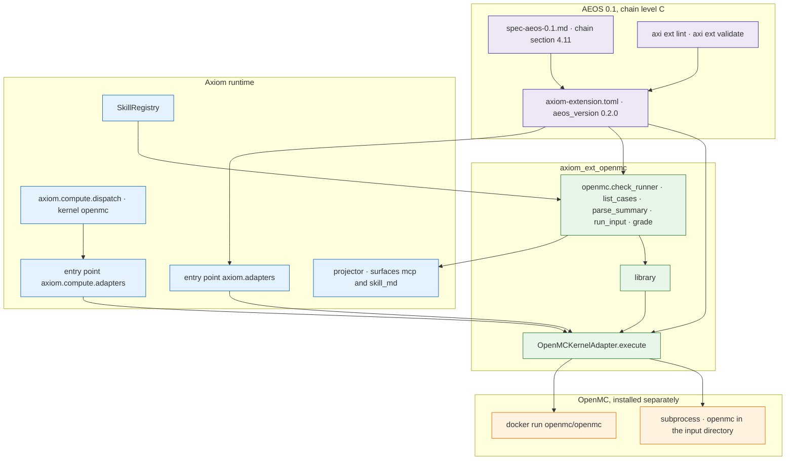

# axiom-ext-openmc

This is the OpenMC extension for [Axiom](https://github.com/b-tree-labs/axiom-os). It is a standalone [AEOS](https://github.com/b-tree-labs/axiom-os/blob/main/docs/specs/spec-aeos-0.1.md) package: one manifest, one Python library, and a small toolkit of skills that call that library.

Install OpenMC itself separately (`conda` or the `openmc/openmc` image). This package does not redistribute OpenMC, and importing it does not replace `import openmc`.

Apache-2.0. Python 3.11+. The manifest declares AEOS 0.2 chain level C, which is the chain-readiness minor inside the governing AEOS 0.1 spec. AEOS 1.0 is a draft and is not claimed here.

## What you can do with it

Three things, all aimed at an input directory that already contains an OpenMC deck:

1. **Run it through Axiom.** `axiom.compute.dispatch` loads `OpenMCKernelAdapter` from the `axiom.compute.adapters` entry point when `kernel` is `"openmc"`. The adapter runs `openmc` in that directory, or `docker run openmc/openmc` when you ask for Docker. It returns a `KernelResult` whose `value_summary` carries `k_eff` and `k_eff_std`.
2. **Call the library.** `runner_status`, `list_cases`, `parse_summary`, `run_input`, and `grade` are plain functions. `run_input` and `parse_summary` are the only ones that import the adapter, and they do it when called.
3. **Call the toolkit.** Five skills (`openmc.check_runner`, `openmc.list_cases`, `openmc.parse_summary`, `openmc.run_input`, `openmc.grade`) are thin wrappers over those functions. `skills.bind(registry)` registers them on Axiom's `SkillRegistry`. The recipe `grade-a-run` is the order an agent follows: check the machine, list the ladder, run one directory, grade k-eff.

The verification ladder builds three decks (infinite UO2 medium, a pin cell, a 17×17 assembly) so a real OpenMC run can be told apart from a mock. Reference values shipped today are provisional placeholders. `grade` reports `provisional` and does not report agreement until a reviewer replaces the number and clears the flag. A URI with no reference reports `no_reference`.

## Components



`library.grade` reads the reference modules and applies the provisional rule. `library.list_cases` reads the ladder and does not import OpenMC. `library.runner_status` reports the OpenMC Python package, `OPENMC_CROSS_SECTIONS`, the `openmc` binary, and `docker` as separate facts. `library.run_input` calls `OpenMCKernelAdapter.execute`. `library.parse_summary` calls the adapter's statepoint parser: a `result.json` is read; a bare `statepoint.*.h5` raises the adapter's `NotImplementedError` for host-side HDF5.

The adapter selects a runner from `kernel_options["runner"]`, or from what is on `PATH` (`openmc`, then `docker`). `ssh:<peer>` is recognized and raises `NotImplementedError`. It does not open a session. `connect` reports that.

## Where it sits in Axiom and AEOS



AEOS is the manifest, the layout, and the conformance tests (`tests/unit_tests/test_standard.py` inherits `axiom_tests`). The runtime loads two entry points that name the same class: `axiom.compute.adapters` for `get_adapter("openmc")` and dispatch, and `axiom.adapters` for `axi ext validate`. Skills are not a third entry-point group. `bind` registers them when `axiom.infra.skills` imports. Each skill declares `surfaces = ["mcp", "skill_md"]`. The platform projector turns that declaration into an MCP tool. This package does not hand-write a second tool schema.

Dispatch signs the completed result. This package returns the `KernelResult` dispatch signs. A `lost_particles` fault is in dispatch's always-auto-stop set. A non-zero OpenMC exit is a `subprocess_failure` fault on that result.

The extension declares `federation.shareable = false`. It does not implement attestation or quarantine. The publish workflow does not yet Sigstore-sign the wheel. The manifest says a published release requires that signature.

## Install

```bash
pip install axiom-ext-openmc
```

That installs this package and its dependency on `axiom-os-lm`. OpenMC is separate:

| How you run | What you install |
|---|---|
| Native binary | `conda install -c conda-forge openmc`, and set `OPENMC_CROSS_SECTIONS` to a data library from [openmc.org/data](https://openmc.org/data/) |
| Container | Docker, and the image `openmc/openmc:latest` (`docker run` pulls it when it is absent). On Apple Silicon the adapter passes `--platform linux/amd64` |

`kernel_options["runner"]` is `"subprocess"` or `"docker"`. Omit it and the adapter uses `openmc` on `PATH` when it finds it, otherwise `docker`.

## Use

### Library

```python
from axiom_ext_openmc import grade, list_cases, runner_status

print(runner_status())
for case in list_cases():
    print(case["name"], case["reference_uri"], case["n_particles"])

result = grade("reference://verification/infinite-medium-uo2/k-eff", k_eff=1.02)
# result["status"] == "provisional" and result["agrees"] is None
```

`run_input` needs the counts the case declares. Pass those counts. The function has no second default.

```python
from axiom_ext_openmc import list_cases, run_input

case = next(c for c in list_cases() if c["name"] == "infinite_medium_uo2")
outcome = run_input(
    "/path/to/prepared-deck",
    n_particles=case["n_particles"],
    n_active_cycles=case["n_active_cycles"],
    n_inactive_cycles=case["n_inactive_cycles"],
    rng_seed=case["rng_seed"],
    kernel_options={"runner": "subprocess"},
)
print(outcome.value_summary["k_eff"])
```

The verification builders write a deck when OpenMC's Python API is importable. `verification.runner.run_case` builds one case into a directory and then calls the same adapter.

### Toolkit

```python
from axiom.infra.skills import SkillRegistry
from axiom_ext_openmc.skills import bind

registry = SkillRegistry()
bind(registry)  # openmc.check_runner, list_cases, parse_summary, run_input, grade
```

`grade-a-run` (`axiom_ext_openmc/recipes/grade-a-run.toml`) is data. An agent runs each step through the registry. The recipe does not execute OpenMC by itself.

### Dispatch

```python
from axiom.compute import dispatch, DispatchSpec

result = dispatch(DispatchSpec(
    model_id="my-model",
    composition_hash="sha256:...",
    kernel="openmc",
    peer_id="laptop",
    determinism_class="D-bit",
    determinism_state={
        "input_dir": "/path/to/openmc-input/",
        "n_particles": 1000,
        "n_active_cycles": 10,
        "n_inactive_cycles": 5,
        "rng_seed": 1,
    },
    kernel_options={"runner": "subprocess"},
))
print(result.value_summary["k_eff"])
```

`axi model run my-model --on local:openmc` is the CLI onto that same kernel name.

A traditional OpenMC process is unchanged: run `openmc` in a directory that holds `geometry.xml`, `materials.xml`, and `settings.xml`.

## Layout

```
axiom-extension.toml          AEOS manifest
axiom_ext_openmc/
  library.py                  public functions
  adapter.py                  OpenMCKernelAdapter
  adapters/openmc.py          AEOS entry, same class
  skills/                     toolkit and SKILL.md files
  recipes/grade-a-run.toml
  verification/               ladder, availability, runner
  references/                 provisional reference specs
tests/unit_tests/test_standard.py
```

## Development

```bash
git clone https://github.com/UT-Computational-NE/axiom-ext-openmc.git
cd axiom-ext-openmc
pip install -e ".[test]"
pytest -q -m "not docker"
pytest -m docker -v    # needs Docker and openmc/openmc
```

`axi ext lint` compares the directory name to the manifest name with no hyphen folding. The manifest name is `axiom_ext_openmc`. A clone of this repository is named `axiom-ext-openmc`, so point lint at a directory with the manifest's name. Details are in [docs/specs/spec.md](docs/specs/spec.md).

## License

Apache-2.0. See [LICENSE](LICENSE) and [NOTICE](NOTICE). Copyright The University of Texas at Austin and B-Tree Labs.

Rungs 2 and 3 of the ladder are adapted from Harrison Reisinger's OpenMC Crash Course, MIT licensed. See [THIRD_PARTY_NOTICES.md](THIRD_PARTY_NOTICES.md).

## References

- [ADR-018](https://github.com/b-tree-labs/axiom-os/blob/main/docs/adrs/adr-018-physics-code-extensions.md) — a physics code is its own AEOS extension.
- [ADR-040](https://github.com/b-tree-labs/axiom-os/blob/main/docs/adrs/adr-040-compute-decomposition.md) — compute decomposition. This adapter is one kernel.
- [ADR-044](https://github.com/b-tree-labs/axiom-os/blob/main/docs/adrs/adr-044-extension-distribution-model.md) — this package is the standalone distribution.
- [OpenMC](https://github.com/openmc-dev/openmc) — the code this extension runs.
- [NeutronOS](https://github.com/UT-Computational-NE/neutron-os-core) — a nuclear-domain consumer of this package.
